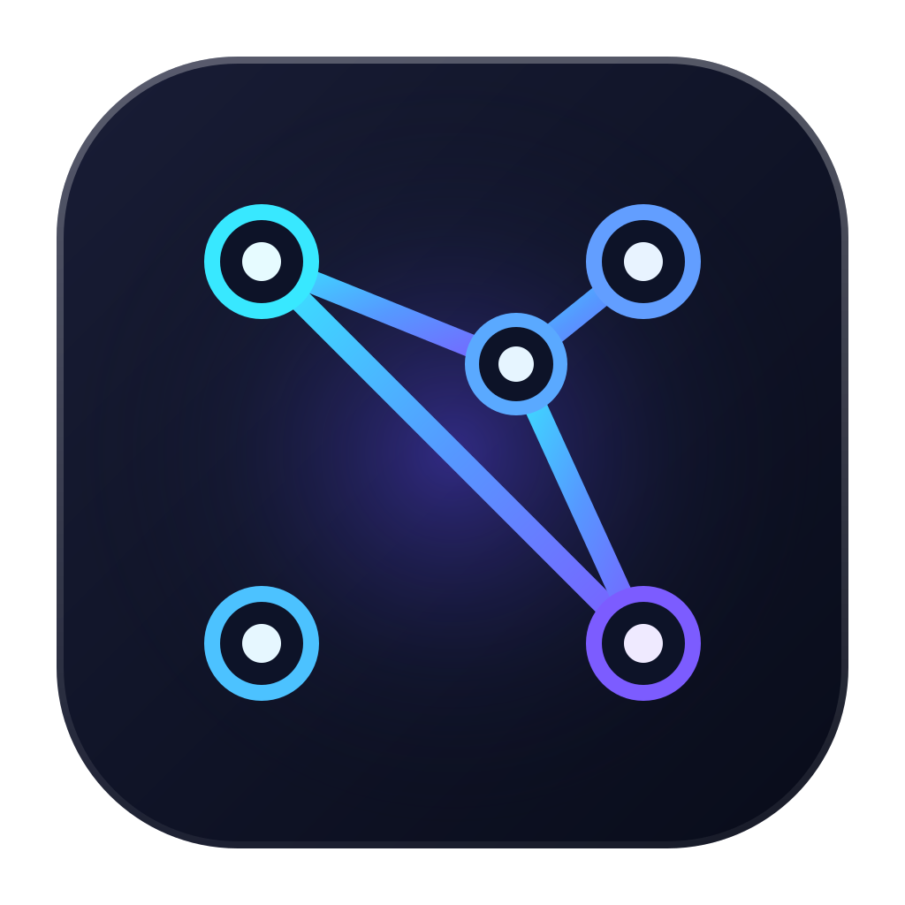
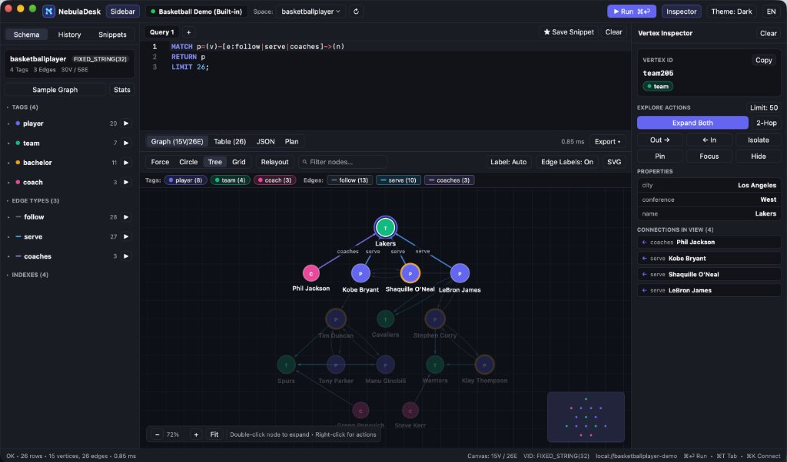

# NebulaDesk — Native NebulaGraph Desktop Client

<p align="center">
  
</p>

<p align="center">
  <strong>A lightweight, GPU-accelerated, pure-Go native desktop client for <a href="https://www.nebula-graph.io/">NebulaGraph v3</a></strong><br/>
  Built with <a href="https://mygo.run/">MyGo</a> Native UI (<code>CGO_ENABLED=0</code>, zero Electron, zero WebView) &amp; official <a href="https://github.com/vesoft-inc/nebula-go">nebula-go/v3</a>.
</p>

<p align="center">
  <a href="https://github.com/jeanlyn/NebulaDesk/releases"></a>
  <a href="https://github.com/jeanlyn/NebulaDesk/actions/workflows/ci.yml"></a>
  
  
</p>

---

## Preview

<p align="center">
  
</p>

> Rendered directly on the GPU (Metal on macOS, Direct3D 11 on Windows, OpenGL/CPU on Linux) — instant startup, ~15 MB single binary, and 0% idle CPU.

---

## Why NebulaDesk?

- **True Native & Ultra-Lightweight**: No Electron, no embedded Chromium, no JavaScript runtime. Starts instantly and keeps memory footprint tiny.
- **Zero-Friction Built-in Demo**: Ships with an in-memory NebulaGraph simulator preloaded with `basketballplayer` and `tech_ecosystem` spaces so you can test queries, graph layouts, node expansion, shortest paths, and `EXPLAIN` plans immediately — or connect to any live NebulaGraph v3 cluster (multi-host & TLS supported).
- **Production-Ready for Large Graphs**: Strictly `LIMIT`-bounded node expansion (`30 / 50 / 100 / 200`), 2D spatial-hash $O(N)$ force-directed repulsion with an 18ms frame budget, off-screen edge culling, and dense-graph LOD prevent freezes on high-degree super-nodes.
- **Bilingual UI (EN / 中文)**: One-click language switching in the top toolbar, persisted across sessions.

---

## Key Features

| Area | Capabilities | Inspired By |
| --- | --- | --- |
| **nGQL Code Editor** | Zed-style native GPU editor (`mygo/ui/editor`) with custom **nGQL syntax highlighting** (keywords, functions, types, `$^`/`$$`/`$-`/`$var`, `#`/`//`/`--`/`/* */` comments, backtick identifiers), **schema-aware autocompletion** (`Ctrl+Space`), query snippets, hover docs for Tags/Edges/keywords, diagnostics, multi-tab workspace, and `⌘⏎` / `Ctrl+⏎` execution (runs selection if highlighted). | Neo4j Browser, Memgraph Lab, Zed |
| **Interactive Graph Visualization** | GPU-drawn 2D canvas with **4 layouts** (`Force-Directed` with 2D spatial-hash $O(N)$ repulsion & 18ms frame budget, `Circular`, `Hierarchical Tree`, `Grid`), smooth pan & zoom-to-cursor, drag-to-pin nodes, **curved Bézier parallel/bidirectional edges & ranked edges (`@rank`)**, self-loops, multi-tag vertex accent rings, 1-hop neighborhood spotlight dimming, quick node filter/search, Tag/Edge filter legend pills, live minimap, LOD for large graphs, and **SVG / JSON export**. | NebulaGraph Explorer, Neo4j Bloom, Memgraph Orb |
| **Interactive Exploration** | **Double-click any node** (or right-click context menu / Inspector buttons) to run strictly `LIMIT`-bounded directional `MATCH` expansion (`Both`, `Out →`, `← In`, `2-Hop`, configurable `Limit: 30/50/100/200`) and smoothly merge newly discovered vertices & edges into the live canvas without stalling on super-nodes. Scalar table results can also jump straight into live subgraph exploration via column VID extraction or cell right-click. | NebulaGraph Explorer, G.V() |
| **Multi-View Results** | Switch seamlessly between **Graph**, sortable/filterable **Table** (with cell context menu to copy or explore any VID in graph), formatted **JSON**, and **Physical Execution Plan** (`EXPLAIN` / `PROFILE`). Export tables to **CSV** or **JSON**. | NebulaGraph Studio, Neo4j Browser |
| **Schema, History & Snippets** | Auto-refreshed Space switcher (`USE <space>`), expandable Schema tree (Tags, Edge Types, Properties with **inline golden index key indicators** and index tooltips, Indexes, `SHOW STATS` counts, one-click schema-aware sample queries), searchable query history, persistent favorite snippets (`~/.config/nebuladesk/config.json`), and **EN / 中文 multi-language switching**. | NebulaGraph Studio, Kuzu Explorer, G.V() |
| **Connection Manager** | Manage multiple saved NebulaGraph v3 cluster profiles (single or comma-separated `host:port` seeds, username/password, default space, TLS toggle) alongside the built-in Demo engine. | TablePlus, G.V() |

---

## Download

Pre-built binaries and installers for **macOS (Apple Silicon & Intel)**, **Windows (x64)**, and **Linux (x64 & ARM64)** are available on the [GitHub Releases](https://github.com/jeanlyn/NebulaDesk/releases) page.

### macOS Installation Note (Gatekeeper Warning)

Because NebulaDesk is an open-source app not yet notarized with a paid Apple Developer ID, macOS may display:
> *"Apple could not verify 'NebulaDesk' is free of malware that may harm your Mac or compromise your privacy."*

After dragging `NebulaDesk.app` into `/Applications`, use either method below to allow it to run:

**Option 1 — Terminal (Fastest):**
```bash
xattr -cr /Applications/NebulaDesk.app
```

**Option 2 — System Settings (No Terminal required):**
1. Double-click `NebulaDesk` once, then click **Done** on the warning dialog.
2. Open **System Settings → Privacy & Security** (**系统设置 → 隐私与安全性**).
3. Scroll down to the **Security** section, find *"NebulaDesk was blocked to protect your Mac"*, and click **Open Anyway** (**仍要打开**).
4. Confirm with Touch ID or your password — subsequent launches will open normally.

> **Windows SmartScreen:** If Windows shows *"Windows protected your PC"*, click **More info** (**更多信息**) → **Run anyway** (**仍要运行**).

---

## Build from Source

### Requirements
- Go 1.27+ (automatically managed via `go.mod` toolchain)
- No C compiler (`CGO_ENABLED=0`) and no Node.js required.

### Run
```bash
CGO_ENABLED=0 go run .
```

### Build Native Binary
```bash
CGO_ENABLED=0 go build -ldflags="-s -w" -o nebuladesk .
./nebuladesk
```

### Package Native App Bundle with MyGo
```bash
go run github.com/egoist/mygo/cmd/mygo@v0.10.0 build
```

### Run Tests (including Headless UI & Snapshot Tests)
```bash
CGO_ENABLED=0 go test -v ./...

# Optional: also export PNG screenshots of the rendered UI
NEBULADESK_SNAPSHOT_DIR=./snapshots CGO_ENABLED=0 go test -v ./internal/app
```

---

## Keyboard Shortcuts

| Shortcut | Action |
| --- | --- |
| `⌘Enter` / `Ctrl+Enter` | Execute current nGQL query (or highlighted selection) |
| `Ctrl+Space` | Trigger schema-aware nGQL autocompletion |
| `⌘T` / `Ctrl+T` | Open a new query tab |
| `⌘W` / `Ctrl+W` | Close active query tab |
| `⌘K` / `Ctrl+K` | Open Connection Manager |
| `⌘B` / `Ctrl+B` | Toggle Left Sidebar (Schema / History / Snippets) |
| `⌘I` / `Ctrl+I` | Toggle Right Inspector Panel |
| `Double-click Node` | Expand 1-hop neighborhood into live graph |
| `Right-click Node / Canvas` | Context menu (Directional expand, Pin, Isolate, Hide, Fit, Export) |

---

## Project Structure

```text
NebulaDesk/
├── main.go                     # Entry point & MyGo native window setup
├── mygo.json                   # MyGo app manifest & icon / updater config
├── resources/                  # App icon (SVG & 1024x1024 PNG)
├── docs/screenshots/           # README preview screenshots
├── scripts/genicon/            # Pure-Go squircle icon generator
├── .github/workflows/          # CI & multi-platform Release workflows
└── internal/
    ├── model/                  # Graph primitives (Vertex/Edge/GraphData/Schema) & JSON config store
    ├── nebula/                 # nebula-go/v3 LiveClient, ResultSet parser, & built-in DemoClient
    ├── ngql/                   # Custom nGQL syntax highlighter, schema completions & hover docs
    ├── i18n/                   # English & Simplified Chinese localization
    ├── graphview/              # Spatial-hash Force/Circular/Tree/Grid layouts, GPU canvas, SVG/JSON export
    └── app/                    # Workspace state, Toolbar, Sidebar, Results, Inspector, Modals, & headless UI tests
```
